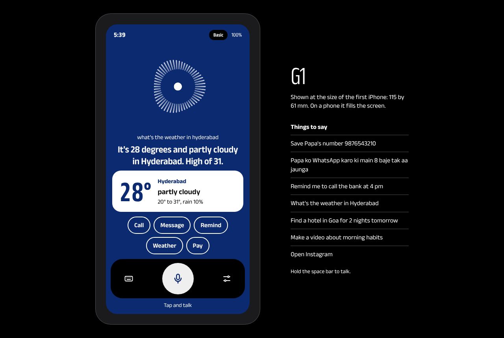
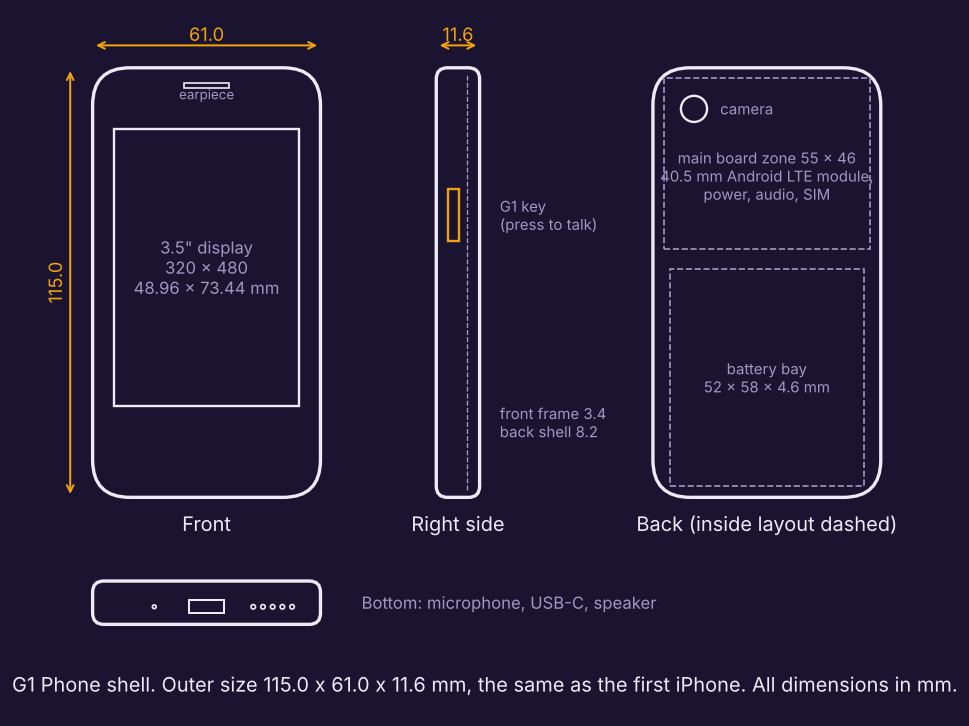

# G1

**A voice-first phone by SherrByte.** Say it and it's done: calls, WhatsApp, UPI, reminders, directions, music, camera questions, making and posting videos. Everything except scrolling.





## G1 in one specification
| | |
|---|---|
| Body | 115.0 × 61.0 × 11.6 mm, the size of the first iPhone |
| Screen | 3.5", 320 × 480. One answer and one card at a time. No feeds, nothing to scroll |
| Look | Navy blue ground (about 81%), white words, cards and mic (about 10%), black dock and buttons (about 9%). Five shortcut chips: Call, Message, Remind, Weather, Pay |
| Input | Voice. One side key to talk, or say "Hey G1" |
| Voice | Natural human voice (ElevenLabs) with 5 Indian voices to pick from; falls back to the device voice |
| Languages | English, Hindi/Hinglish, Telugu. With the AI brain it mirrors whatever mix you speak |
| Brain | Any OpenAI-compatible AI (Gemini, Groq, others). Without a key, a built-in basic mode still handles everyday commands |
| One rule | Anything that **sends, pays, posts or deletes** waits for your "haan". No exceptions |

## What is in this repo
| Folder | What | Runs on |
|---|---|---|
| `public/` | **The G1 app**: the screen, ears, voice, brain and 40 skills | Any phone or laptop browser, installable |
| `server.mjs`, `server/`, `api/` | Optional small server that keeps AI and voice keys off the device | Node, or Vercel as-is |
| `g1/` | **G1 Core**: Python service for the heavy skills (make a video, post to YouTube, SMS through G1's own SIM, WhatsApp from a business number) and the Raspberry Pi voice loop | Dev Kit or a PC |
| `hardware/g1-phone/` | **G1 Phone shell** at iPhone 1 size: parametric model, STL files, parts and depth budget | 3D printer |
| `hardware/devkit/` | G1 Dev Kit v0: Raspberry Pi 5 build, parts list, wiring, case | Hand-built |
| `hardware/PRODUCTION.md` | Path from dev kit to a certified phone | |

## Try it
**1. The app alone (works with no keys):**
```bash
node server.mjs            # http://localhost:5173   (Node 20+; no install step needed)
```
Tap **Start G1**, then tap the button and talk (Chrome or Edge). Typing also works.

**2. With G1 Core (adds video making, YouTube, SIM SMS):**
```bash
pip install -r requirements.txt
python -m g1.server        # http://127.0.0.1:8700   (the same app, plus Core skills; old simulator at /sim)
```

**3. On your phone:** deploy this repo to Vercel (no settings needed), open the link in Chrome on Android, and choose "Add to Home screen".

### Turning on the AI brain and the human voice
Either put keys in **Settings** inside G1 (they stay on that device), or set them on the server:

| Variable | For |
|---|---|
| `LLM_API_KEY` | AI brain. A free Gemini key works: https://aistudio.google.com/apikey |
| `LLM_BASE_URL`, `LLM_MODEL` | Optional. Default is Gemini's OpenAI-compatible endpoint with `gemini-3.5-flash` |
| `ELEVENLABS_API_KEY` | Natural voice |
| `G1_PASSCODE` | Optional lock, so only your devices can use your keys. Enter the same value as "Device key" in Settings |

G1 Core reads its own settings from `.env` (see `.env.example`).

## What you can say
| Say | What happens |
|---|---|
| "Save Papa's number 98765 43210" | Saved to G1's contacts |
| "Papa ko call karo" | Starts the call |
| "Papa ko WhatsApp karo ki main 8 baje tak aa jaunga" | Reads it back, waits for "haan", opens WhatsApp with the message ready. With G1 Core and a business number it is sent with no tap |
| "Ravi ko 200 rupaye bhejo" | Confirms, opens your UPI app with name and amount filled; you enter the PIN |
| "Kal subah 6 baje alarm lagao", "Remind me to call the bank at 4 pm" | Speaks it at that time |
| "10 minute ka timer lagao" | Live countdown on screen |
| "Aaj mausam kaisa hai?", "Will it rain tomorrow in Hyderabad?" | Live weather |
| "Railway station ka rasta batao", "Find a petrol pump near me" | Opens directions |
| "Kishore Kumar ke gaane bajao", "Play Arijit Singh on Spotify" | Opens it to play |
| "Ye kya hai?" | Looks through the camera and tells you (needs the AI brain) |
| "Find a hotel in Goa for 2 nights tomorrow", "Book a train from Anantapur to Bangalore" | Opens real availability for those dates |
| "Make a video about morning habits", then "Post it" | G1 Core renders a 1080 × 1920 video; posting to YouTube waits for "haan" |
| "Doodh lana hai note karo", "Add milk to my shopping list" | Notes and lists |
| "Remember that my bike number is AP02 1234" | G1 keeps it in mind in later conversations |
| "Change your voice", "Speak in Hindi", "My name is Jashwanth" | Settings by voice |
| "Open Instagram" | G1 declines to open the feed and offers to do the actual task |

## How it is put together
```
 G1 key / "Hey G1" ─► ears (speech to text) ─► brain ─────────────► voice (speaks) + one card on screen
                                                │
                              AI model with tools, or basic mode
                                                │
                     ┌──────────── 40 skills ───┴────────────┐
                     │ safe: time, weather, notes, timers,   │   waits for "haan": message, email,
                     │ maps, music, lookups, camera, video   │   UPI payment, post video, delete
                     └───────────────────┬───────────────────┘
                              platform.js (links, camera, torch, location)
                              G1 Core (video, YouTube, SIM SMS)  ← only when Core is running
```
- Add a skill: one object in `public/js/skills/` with a name, a description, parameters and `run()`. Return `confirm` if it sends, pays, posts or deletes.
- Change how G1 talks: `public/js/core/persona.js`.
- A native Android shell can take over `platform.open()` through `window.G1Native` to place calls and send messages with no tap.

## Tests
```bash
npm test                 # 30 tests: understanding (English + Hinglish), skills, brain, AI tool loop
npm run test:browser     # drives the real screen in Chrome with a fake mic and speaker, at desktop, phone and 320 × 480 sizes
python -m pytest -q      # 9 G1 Core tests, incl. video render and the yes/no gate
python3 hardware/g1-phone/build_enclosure.py   # rebuilds the shell and checks 115.0 × 61.0 × 11.6
```

## Honest limits today
| Limit | Why | What removes it |
|---|---|---|
| In a browser, calls, WhatsApp and SMS need one final tap | Browsers may open the dialer or WhatsApp but may not press call or send. Personal WhatsApp has no official sending API | G1 as an Android app (the `G1Native` hook), or G1 Core with a SIM / business number |
| UPI always asks for your PIN | That is how UPI works, and it should stay that way | Nothing; by design |
| Alarms and reminders ring only while G1 is open | A web page cannot wake a sleeping phone | Android app |
| Basic mode understands common English and Hinglish commands, not free conversation or Telugu | It is a rule engine | Add an AI key |
| Speech recognition needs Chrome or Edge and the internet | It uses the browser's recogniser | On-device speech in the Android app |
| "Play" opens the search on YouTube or Spotify | No licensed music catalogue inside G1 | Partner integration |
| Bookings open the site; you choose and pay | No travel partner API yet | Partner APIs |
| YouTube uploads start private | Google keeps uploads from unaudited apps private | Google's API audit |
| AI and voice services were not called live in testing | No keys were available in the build environment | Add your keys and try; request formats follow the current provider documentation |
| The phone shell is a fit-check model | No board exists yet for it | Steps in `hardware/g1-phone/README.md` |

Fonts: Anek (Latin, Devanagari, Telugu), SIL Open Font License, in `public/fonts/`.
