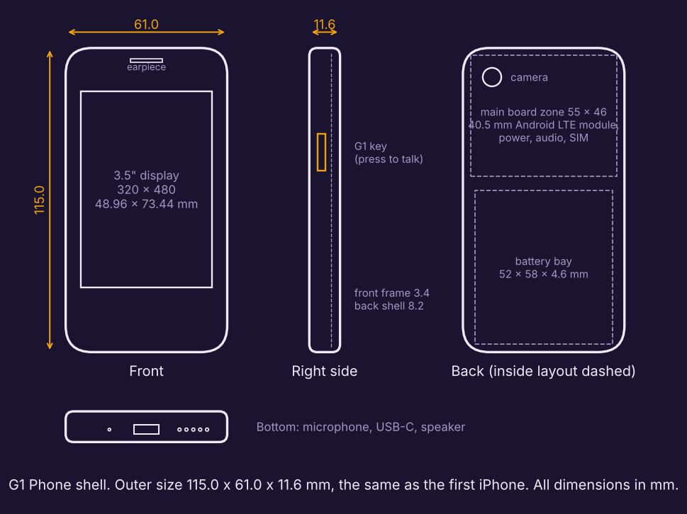

# G1 Phone hardware: the size of the first iPhone

**Outer size: 115.0 × 61.0 × 11.6 mm.** Target weight: 135 g or less. One screen, one key, no feed.



## What is in this folder
| File | What it is |
|---|---|
| `build_enclosure.py` | The shell as code. Every dimension is a named number at the top. Running it writes the two STL files and checks the outer size, that both parts are printable, and that display + battery fit in the depth. |
| `g1_phone_front.stl` | Front frame: display window and the pocket the 3.5" display sits in, earpiece slot. |
| `g1_phone_back.stl` | Back shell: board standoffs, battery bay, screw posts, USB-C, speaker, two microphones, G1 key, SIM tray, camera window. |

Checked output of the script: `outer size 61.00 x 115.00 x 11.60 mm`, both parts watertight.

This shell is for **fit checks** (an EVT shell): print it, drop in the real display, battery and
board, and adjust the numbers. It is not a finished industrial design.

## Why the Dev Kit board does not go in here
The Dev Kit uses a Raspberry Pi 5, which is 85 × 56 × 17 mm on its own before the 4G HAT, screen
and battery. It cannot fit in an 11.6 mm thick body. A phone this size needs a phone-class
module on a custom board.

## The parts that make it a phone
| Part | Choice for the first board | Why | Status |
|---|---|---|---|
| Computer + 4G + Wi-Fi + Bluetooth + GPS | An Android "smart module" in the 40.5 × 40.5 × 2.85 mm class, for example the Quectel SC206E series (quad-core, Android 12 to 14, LTE Cat 4, 4-lane MIPI display output) | One soldered part is the whole phone computer with a certified modem. Runs Android, so the G1 app, WhatsApp and UPI apps all run | Pick the variant with India bands (B1, B3, B5, B8, B40, B41) with the distributor |
| Display | 3.5" IPS, 320 × 480, capacitive touch, visible area 48.96 × 73.44 mm | Same size and resolution as the first iPhone; the G1 screen is tested at exactly 320 × 480 | Confirm the panel's outline and connector against `DISP_MODULE_*` in the script |
| Battery | Li-polymer pouch about 52 × 58 × 4.6 mm, roughly 1,800 to 2,000 mAh | Largest pouch that fits under the display next to the board | Estimate from the bay volume; buy a cell with a protection circuit and test report |
| Microphones | 2 × MEMS (bottom for talking, top for noise) | Voice is the main input, so two mics for noise cancelling | |
| Speaker + earpiece | 1 loudspeaker (bottom), 1 earpiece (above display) | G1 talks back; private calls at the ear | |
| G1 key | One side key, right side | Press to talk. The only button G1 needs besides power | |
| Camera | One rear camera, 8 to 13 MP MIPI | "What is this?", reading bills, photos | |
| Other | USB-C, nano-SIM tray, vibration motor, 4G/Wi-Fi/GPS antennas on the plastic frame | | Antenna tuning needs an RF lab |

## Depth budget (must stay inside 11.6 mm)
```
front lip 0.8 | display 3.2 | gap 0.4 | battery 4.6 | gap 0.3 | back 1.2   = 10.5 mm
front lip 0.8 | display 3.2 | board: standoff 1.4 + PCB 0.8 + module 2.85   = 9.05 mm + back 1.2 = 10.25 mm
```

## Three steps to a real device
1. **Now, no hardware:** run the G1 app on any Android phone (Chrome, add to home screen). This is the product people can try today.
2. **Bench prototype:** the smart module's evaluation kit + the 3.5" display + battery on a desk, running Android with G1 as the home screen. Proves the exact parts before any board is designed.
3. **G1 Phone board:** a custom board for this shell, designed and built with an electronics design house or ODM. Then BIS, TEC, IMEI and SAR as listed in `../PRODUCTION.md`.

The earlier Dev Kit (Raspberry Pi, bigger case) is still the fastest thing to build by hand and stays in `../devkit/`.

## Sources for the module figures
- Quectel SC206E series page: https://www.quectel.com/product/lte-sc206e-smart-module-series
- Quectel SC206E specification sheet (display output, Android versions): https://cdn.soselectronic.com/productdata/81/23/7f38d780/sc206eemna-e51-ugnda.pdf

Prices and availability are not listed here on purpose: get current quotes before choosing parts.
